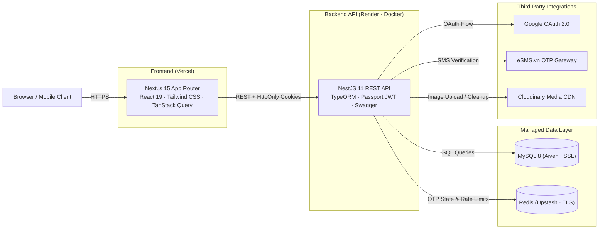
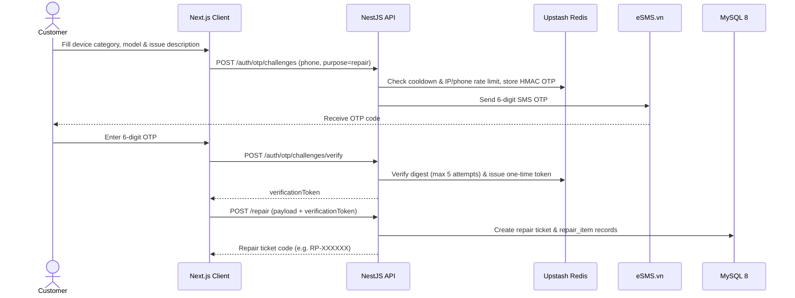
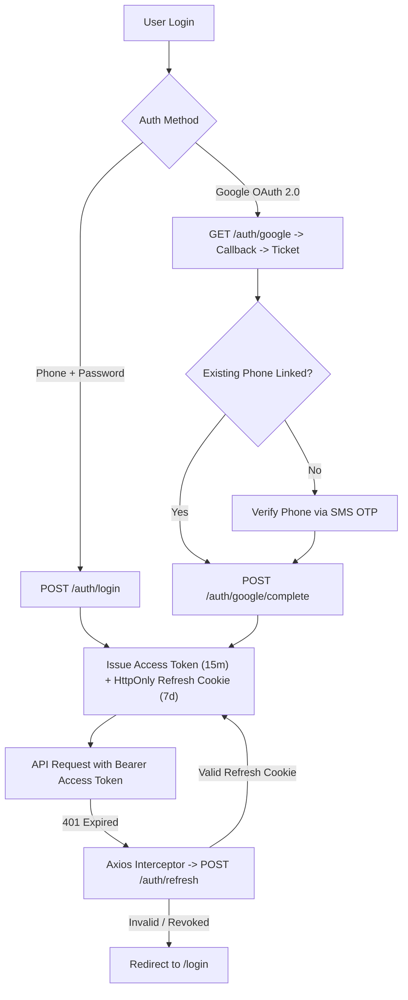
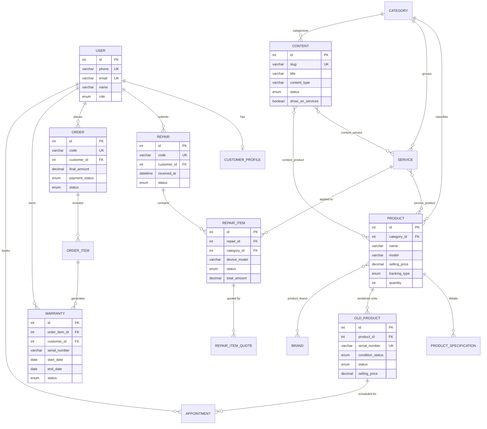

# FixPro — Electronics Store & Repair Service Platform

> Full-stack web platform for electronics & home appliance repair booking, used-device catalog, spare parts showcase, order & warranty tracking.

[](https://fixpro-production.vercel.app/)
[](https://fixpro-api-whpt.onrender.com/api/docs)
[](https://nextjs.org/)
[](https://nestjs.com/)
[](https://www.mysql.com/)
[](https://redis.io/)

- **Live Web App:** https://fixpro-production.vercel.app/
- **API Swagger Docs:** https://fixpro-api-whpt.onrender.com/api/docs

---

## Table of Contents

- [Overview](#overview)
- [System Architecture](#system-architecture)
- [Core User Flows](#core-user-flows)
- [Database Design (ERD)](#database-design-erd)
- [Key Engineering Highlights](#key-engineering-highlights)
- [Tech Stack](#tech-stack)
- [Screenshots](#screenshots)
- [Project Structure](#project-structure)
- [Local Development](#local-development)

---

## Overview

**FixPro** digitizes the end-to-end workflow of an electronics & home appliance repair shop:

- **Repair Booking & Tracking:** Customers submit repair requests online (with SMS OTP verification for guests), look up ticket status by phone number, review item-level repair quotes, and track completion progress.
- **Used Appliances & Spare Parts Catalog:** Filterable catalog supporting both serial-tracked refurbished appliances (with condition grading & in-store viewing appointments) and spare parts with technical specifications.
- **Service Articles & SEO Content:** Published service introductions and repair guides dynamically cross-linked with related services and compatible products.
- **Customer Portal:** Unified account dashboard for profile & avatar management, repair history, order history, warranty lookup, and favorites.

---

## System Architecture



---

## Core User Flows

### 1. Guest / Customer Repair Booking & Quick Tracking



### 2. Authentication & Session Lifecycle



---

## Database Design (ERD)



> Media assets (`PRODUCT`, `OLD_PRODUCT`, `CONTENT`, `USER`) are managed polymorphically via a dedicated `media_file` table backed by Cloudinary public IDs for automatic cleanup on replacement/deletion.

---

## Key Engineering Highlights

- **Hardened OTP Verification Architecture:** Reusable `OtpModule` with `challengeId` lifecycle, HMAC-SHA256 hashed codes in Redis, resend cooldown (`retryAfterSeconds`), phone/IP throttling, 5-attempt lockout, and single-use purpose-bound verification tokens.
- **Secure Auth & Seamless Token Refresh:** Short-lived JWT Access Tokens paired with `HttpOnly` Refresh Token cookies (`SameSite=None; Secure` for cross-origin production), automatic Axios request queuing during token refresh, and Google OAuth 2.0 with ticket-based completion.
- **Client-Side Image Optimization:** Browser-side WebP compression before upload, MIME/magic-byte validation on the server, Cloudinary stream uploads, and automatic old-asset cleanup on avatar update.
- **Cross-Linked Domain Data:** Product detail pages dynamically resolve matching repair services and published service articles; service articles cross-link to related services and available catalog items.
- **Cloud-Native Production Setup:** Containerized NestJS API (Render), Edge-served Next.js frontend (Vercel), SSL-enforced MySQL 8 (Aiven), and TLS Redis (Upstash) with automated CD on push to `main`.

---

## Tech Stack

| Layer | Technologies |
| --- | --- |
| **Frontend** | Next.js 15 (App Router), React 19, TypeScript, Tailwind CSS v4, TanStack Query, Zustand, Axios, Sonner |
| **Backend** | NestJS 11, TypeScript, TypeORM, Passport JWT, class-validator, Swagger (OpenAPI), ioredis |
| **Database & Cache** | MySQL 8 (Aiven), Redis 7 (Upstash) |
| **Integrations** | Google OAuth 2.0, eSMS.vn REST API, Cloudinary |
| **Deployment** | Vercel (Frontend), Render + Docker (Backend) |

---

## Screenshots

> Add 3–4 screenshots captured from https://fixpro-production.vercel.app/ into `docs/screenshots/` and uncomment below:

<!--
| Home & Quick Repair Booking | Product Catalog & Detail |
| --- | --- |
|  |  |

| Service Articles & Related Items | Customer Profile & Repair Tracking |
| --- | --- |
|  |  |
-->

---

## Project Structure

```text
.
├── backend/                # NestJS 11 REST API
│   └── src/
│       ├── auth/           # JWT, Refresh cookie, Google OAuth
│       ├── otp/            # Redis challenge, rate-limit, eSMS provider
│       ├── product/        # Products, used appliances, categories, brands, services
│       ├── repair/         # Repair intake, quick lookup, quotes, status flow
│       ├── order/          # Orders & order items
│       ├── warranty/       # Warranty records & customer lookup
│       ├── appointment/    # Used-device viewing appointments
│       ├── content/        # Public service articles & cross-linking
│       ├── media/          # Cloudinary upload & polymorphic media_file
│       └── user/           # Customer profiles & password management
└── frontend/               # Next.js 15 App Router
    └── src/
        ├── app/(client)/   # Public store, services, booking, customer portal
        ├── components/     # Reusable UI primitives & layout components
        ├── hooks/          # Auth, favorites, validation hooks
        ├── lib/            # Axios interceptor, error mapping, WebP compression
        └── service/        # Typed API clients
```

---

## Local Development

### Prerequisites
- Node.js 20+
- MySQL 8+ and Redis 7+

### 1. Backend
```bash
cd backend
cp .env.example .env   # Configure DB, Redis, JWT, Cloudinary, eSMS/mock OTP
npm install
npm run start:dev      # Runs on http://localhost:3001 (Swagger: /api/docs)
```

### 2. Frontend
```bash
cd frontend
npm install
# Set NEXT_PUBLIC_API_URL=http://localhost:3001 in frontend/.env.local
npm run dev            # Runs on http://localhost:3000
```
